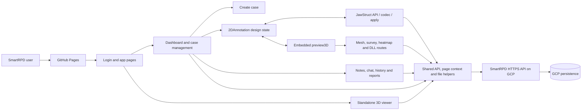

# SmartRPD repository architecture

Generated from `graphify-out/GRAPH_REPORT.md` and targeted tracing of only the stage modules named by its communities and cross-community edges. Current Graphify report: **2,825 nodes, 8,110 edges, 39 communities, 109 god nodes**.

- `architecture-implementation.html` — JavaScript-enhanced step-through implementation diagram.
- `architecture-implementation-static.html` — corporate-compatible CSS-only implementation diagram with seven navigable tabs.

## Implemented stage map

The backend service implementation, database product/schema, IAM, monitoring and patch configuration are outside Graphify's frontend graph and are not inferred.

## Stage-to-stage data flow

1. **Login/MFA/session:** `login.js` sends machine identity and credentials to `/user/login`; SmartRPD uses active OTP-based MFA as the second factor before storing `loggedInUser`, accepting only same-origin post-login redirects, and routing administrators and ordinary users to their respective case lists.
2. **Dashboard/cases:** `myDashboard.js` composes `myCases`, `caseStats`, `caseFiles`, `caseEnrichment`, and `userPages`. `caseManagement.js` is the principal workflow hub for case lists, filters, status, roles, notes, files, history, reports and viewer links.
3. **Create case:** `createCase.js` validates metadata, invitees, images and STL/PLY input; creates the case; assigns roles; uploads artifacts; records case history; and can continue into 2D design.
4. **2D design:** `2DAnnotation.js` owns teeth, components, locks, jaw material and case design state. `jawStructApi.js`, `jawStructCodec.js`, and `jawStructApply.js` form the persistence/translation boundary.
5. **Embedded 3D:** `preview3D.js` consumes 2D context and loads meshes through `/stl/get`, `/stl/raw/get`, then `/stl/get/:type` fallback. It also uses survey, occlusion, thumbnail and extra-slot endpoints.
6. **Standalone viewer:** `viewerShell.js` resolves encrypted case context; `viewer3d/index.js` coordinates API access, jaw decoding, mesh support, controls, texture baking and artificial teeth.
7. **Collaboration:** `caseNote.js`, `chat.js`, case history, approval and noticeboard/reporting modules share the case identifier. Draft fields use case-keyed local storage and storage events; published data crosses the API.

## Graphify evidence used

| Module/hotspot | Connections | Architectural role |
|---|---:|---|
| `caseManagement.js` | 256 | Main case-workspace orchestrator |
| `preview3D.js` | 203 | Embedded mesh/rendering and computation hub |
| `viewer3d/index.js` | 175 | Standalone viewer orchestrator |
| `instructionEditor.js` | 120 | Instruction authoring/rendering hub |
| `2DAnnotation.js` | 113 | Shared 2D design state and feature coordinator |
| `noticeboard.js` | 76 | Report/capture/instruction aggregation |
| `api.js` | 49 | Shared API request and caller-identity boundary |
| `getLoggedInUser` | 83 | Shared session identity access |
| `logApi` | 50 | Cross-stage client API status logging |

Notable extracted cross-stage relationships include:

- `caseManagement.js → api.js` (30 calls), `apiLog.js` (23), `caseNote.js` (9), and `caseEnrichment.js` (4).
- `preview3D.js → 2DAnnotation.js` (16), `api.js` (11), and `preview3DSurvey.js` (9).
- `2DAnnotation.js → jawStructCodec.js` (6), `jawStructApi.js` (4), and shared API helpers.
- `viewer3d/index.js` imports shared API, page context, jaw-structure codec, file support, controls, texture baking and artificial-teeth rendering.

## Security-control boundary

Verified implementation evidence includes active OTP-based MFA, HTTPS API configuration, caller UUID/machine identity, same-origin login redirect checks, role-based routing, client API logging, case history, deterministic CI install, lint/test/build gates, npm-audit artifacts, release manifest/digest, serialized Pages deployment and rollback history.

The following require backend/GCP evidence: token/session implementation details, IAM/service accounts, CORS origin/method/route allowlists, WAF/API Gateway, request schema/type/size filtering, rate limits, private database connectivity, encryption/secrets, centralized monitoring/alerts, vulnerability remediation SLAs, runtime/database patching, backup retention and restore tests.

`src/js/shared/config.js` contains browser-visible credential-like values. They are not secrets or an authorization boundary; rotate any live credential and enforce authorization server-side.
