# SmartRPD architecture and data flow

This document describes the architecture visible from the current repository and its Graphify report. The JavaScript-enhanced version is in [`architecture.html`](architecture.html). For corporate browsers that block local JavaScript, use [`architecture-static.html`](architecture-static.html); its six tabs work using CSS only.

## Opening the interactive diagram on a restricted corporate device

The HTML is fully self-contained and makes no network requests. Open it directly in a normal browser window, not inside Outlook, Teams, OneDrive preview, Protected View, or another embedded preview frame.

If corporate policy blocks interactive pages opened with `file://`, serve the folder on the loopback interface and open it through HTTP:

```powershell
cd "C:\path\to\diagram-folder"
python -m http.server 8000 --bind 127.0.0.1
```

Then visit `http://127.0.0.1:8000/architecture.html`. Stop the server with `Ctrl+C`. This exposes the folder only to the same device, not the corporate network. If Python is unavailable or local web servers are prohibited, use the static Mermaid diagram below or publish the HTML to an approved internal web host.

## Static architecture diagram

```mermaid
flowchart LR
    U[SmartRPD users<br/>clinical, lab, admin]
    GH[(GitHub repository)]
    CI[GitHub Actions<br/>lint, Jest, build, npm audit]
    GP[GitHub Pages<br/>static SmartRPD frontend]
    EDGE{{HTTPS API boundary<br/>CORS/origin + route filtering}}
    API[SmartRPD API on GCP<br/>/api/smartrpd/*]
    PROC[Design processing<br/>DLL, mesh, undercut]
    DB[(GCP database<br/>users, roles, cases, notes,<br/>design/file metadata)]
    OPS[Security operations<br/>logs, alerts, vulnerability<br/>management and patching]

    GH -->|manual workflow_dispatch| CI
    CI -->|verified commit + SHA-256 manifest| GP
    U -->|HTTPS GET| GP
    GP -->|browser application| U
    U -->|HTTPS JSON / STL / base64| EDGE
    EDGE -->|allowlisted, validated requests| API
    API -->|authorized queries/mutations| DB
    DB -->|scoped records| API
    API -->|controlled workload| PROC
    PROC -->|artifacts/results| DB
    API -->|2xx / 4xx / data| U
    API -.->|telemetry| OPS
    DB -.->|audit, backup/restore evidence| OPS

    classDef user fill:#123b33,stroke:#46f9b8,color:#fff;
    classDef github fill:#27303c,stroke:#94a3b8,color:#fff;
    classDef api fill:#172d4d,stroke:#6aa9ff,color:#fff;
    classDef data fill:#30224b,stroke:#b388ff,color:#fff;
    classDef compute fill:#48202d,stroke:#ff6b8a,color:#fff;
    classDef control fill:#402b19,stroke:#ff9457,color:#fff;
    class U user;
    class GH,GP github;
    class EDGE,API api;
    class DB data;
    class PROC compute;
    class CI,OPS control;
```



Dashed operational-control links are requirements to confirm with the GCP platform owner; their configuration is not present in this frontend repository.

## Component purposes

| Component | Purpose | Evidence status |
|---|---|---|
| GitHub repository | Stores frontend source, tests, workflow configuration and documentation. | Verified in repository. |
| GitHub Actions | Runs deterministic install, lint, Jest coverage, production build, manifest/digest generation and Pages publication. Deployments are manual and serialized. | Verified in `.github/workflows/deploy.yml`. |
| GitHub Pages frontend | Serves the static browser UI for login, dashboards, cases, collaboration, 2D annotation and 3D visualization. It has no direct database connection. | Verified in source and deployment docs. |
| SmartRPD API | HTTPS REST boundary for authentication, authorization, case lifecycle, users/roles, notes/alerts, STL/jaw structures, thumbnails and design processing. Base URL: `https://live.api.smartrpdai.com/api/smartrpd`. | Verified from `src/js/shared/api.js`, client calls and Postman collections. GCP service type is not identified here. |
| Design processing | Performs DLL/mesh/design operations such as repair, undercut and denture-design option computation. | Routes and integration docs are present; runtime deployment is outside this repository. |
| GCP database | Persists identity, roles, cases, notes and design/file metadata behind the API. | Database role is required by the flows; product, schema, encryption, backup and network configuration require backend/platform evidence. |

Graphify generated 2,781 nodes and 7,965 edges across 40 communities. It identifies `src/js/shared/api.js` as a high-connectivity hotspot (48 connections), which supports treating the API client as the frontend's principal integration boundary.

## Representative SmartRPD API endpoints

| Purpose | Representative endpoints |
|---|---|
| Authentication and identity | `POST /user/login`, `/user/logout`, `/user/uuid/get`, `/user/username/get` |
| Cases and access | `/case`, `/case/get/:id`, `/case/user/findall/get`, `/case/delete/:id`, `/case/undelete/:id`, `/role`, `/role/all/get` |
| Collaboration | `/notes/create`, `/notes/get/:caseId`, `/alerts`, `/alerts/getallbytouser`, `/sendEmail` |
| Files and visualization | `/stl/get`, `/stl/raw/get`, `/stl/slot/get`, `/stl/slot/delete`, `/thumbnails`, `/referenceimages` |
| Dental design processing | `/jawstruct/l2/getall`, `/undercutheatmap/get`, `/dll/repair-stl`, `/dll/compute-denture-design-options` |

The endpoint list is representative, not a substitute for an authoritative OpenAPI specification. API allowlisting should be maintained server-side by method and route, not inferred from the UI.

## Data flows

1. **Frontend delivery:** a user loads the Pages URL over HTTPS; GitHub returns static assets, and the browser runs the SmartRPD UI.
2. **Authentication and access:** the browser sends login/caller identity to the API; the API validates user, machine and role data in the database and allows or rejects the operation. Admin UI hiding is cosmetic; server endpoints must re-check authorization.
3. **Case data:** the browser sends an authenticated case request; the API validates input and caller scope, queries or mutates the database, and returns only scoped records.
4. **Design processing:** STL or jaw data enters through the API; a controlled processing workload produces artifacts/results; authorized results are stored and returned for browser visualization.
5. **Deployment:** a manually dispatched GitHub workflow runs fail-closed checks, creates a SHA-256 release manifest, updates the Pages branch, and requests a Pages rebuild.

## Security controls

### Verified in this repository

- HTTPS endpoints for GitHub Pages and the SmartRPD API.
- Caller identity includes a machine identifier and logged-in user UUID.
- Client comments and behavior show server-side `is_admin` checks on admin endpoints; soft-delete recovery is admin-only.
- GitHub Actions uses scoped `contents: write` and `pages: write` permissions, serializes deployments, and preserves branch history for rollback.
- Deployment gates: `npm ci`, lint, Jest coverage, production build and artifact existence checks.
- Release traceability: commit SHA, run number and SHA-256 digest in `manifest.json`.
- Vulnerability evidence: `npm audit` output is captured by the deploy-review process.
- Client-side API status logging and observed backend throttling/403 behavior.

### Must be confirmed in GCP/backend evidence

- **Access restrictions:** least-privilege IAM/service accounts, private database connectivity, database-user privileges, administrator lifecycle and break-glass controls.
- **API filtering/allowlisting:** explicit allowed origins, HTTP methods and route inventory; schema/type/size validation; parameterized queries; upload validation; WAF/API Gateway rules; rate limits and abuse detection.
- **Monitoring:** centralized API/database/security logs, alert thresholds, on-call ownership, retention and audit review.
- **Vulnerability management:** infrastructure/container/dependency scanning, severity-based remediation SLAs, exception handling and evidence of closure.
- **Patching:** supported runtime/database versions, OS/runtime/database patch cadence, emergency patch process and maintenance ownership.
- **Data protection and resilience:** encryption at rest, secrets management, backup retention, restore testing, disaster recovery targets and incident response exercises.

## Important security finding

`src/js/shared/config.js` contains browser-delivered credential-like values and explicitly warns they are readable in DevTools. They must not be treated as secrets or as a security boundary. Rotate any live credential, remove privileged/static credentials from the frontend, and enforce all identity and authorization decisions on the server.

## Assumptions and scope

- This checkout contains the frontend and delivery workflow, not the SmartRPD backend or GCP infrastructure-as-code.
- “GCP API” and “GCP database” follow the requested deployment description; the exact GCP products are intentionally not invented.
- Controls listed under “must be confirmed” are shown as required control points, not claimed as implemented.
- OTP UI exists, and OTP-based multi-factor authentication is active and used during login.

## Workshop scenarios

- Use **Page delivery** to explain the separation between static GitHub hosting and protected GCP data services.
- Use **Login & access** to review trust boundaries and authorization enforcement.
- Use **Case data** and **3D/design processing** for privacy and large-file threat modeling.
- Use **Delivery & security** in “Verified” mode for audit evidence, then “Control view” to collect missing GCP proof from platform owners.
